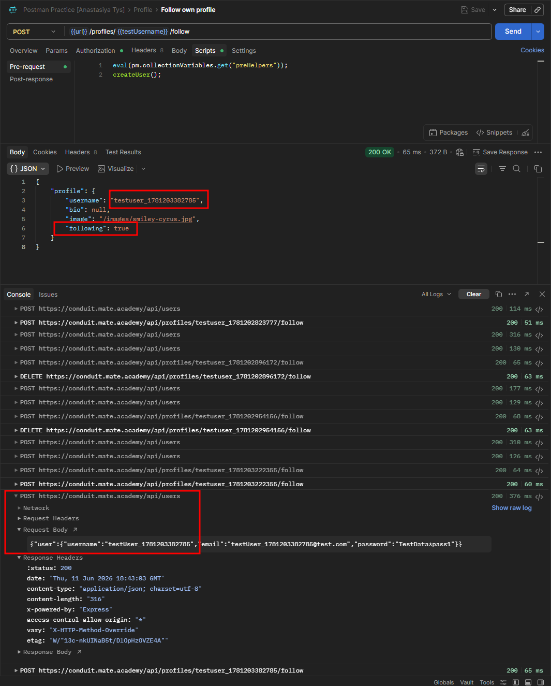

# CPP-10 — User Can Follow Their Own Profile
**Severity:** Medium
**Priority:** Medium

---

## Environment
| | |
|---|---|
| API | `https://conduit.mate.academy/api/` |
| Endpoint | `POST /profiles/:username/follow` |
| Tool | Postman 12.13.6 (x64) |
| OS | Windows 10 Pro |

---

## Preconditions
User is logged in.

---

## Steps to Reproduce
1. Send `POST /profiles/{{username}}/follow` using the same user's token (i.e. following yourself)
2. Observe the response

---

## Expected Result
Status code `422` — a user should not be able to follow their own profile.

---

## Actual Result
`200 OK` — `"following": true` returned. User successfully follows themselves.

---

## Root Cause
`POST /profiles/:username/follow` has no check preventing a user from targeting their own username. The frontend doesn't expose a follow button on the user's own profile, masking this gap from normal UI usage.

---

## Evidence
