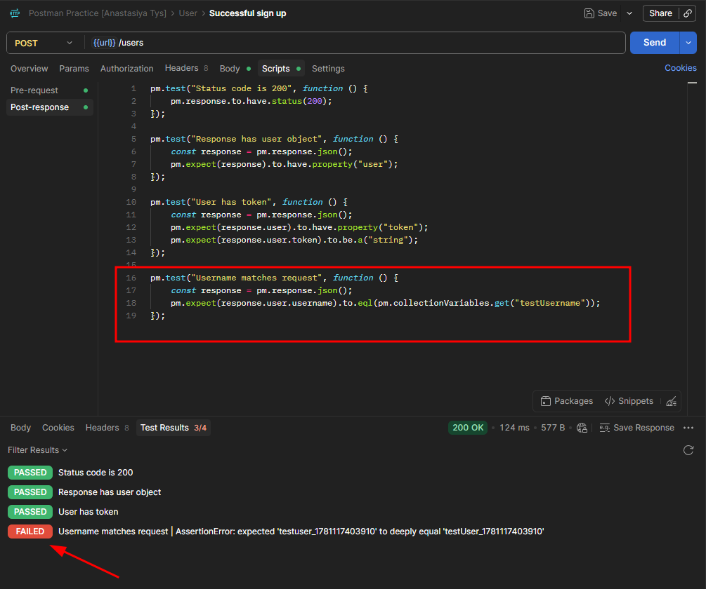
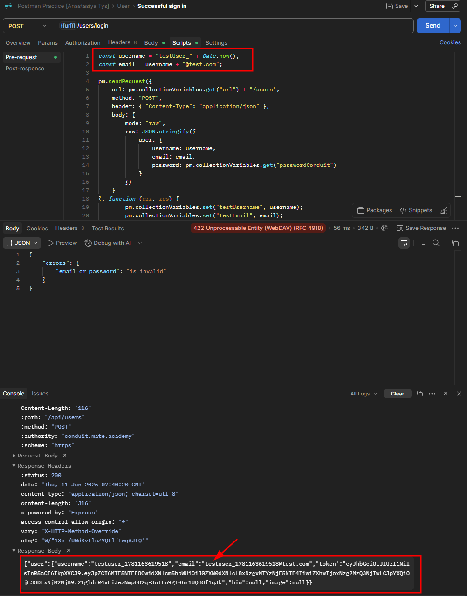

# CPP-2 — Username and Email Are Silently Converted to Lowercase on Sign Up
**Severity:** High
**Priority:** High

---

## Environment
| | |
|---|---|
| API | `https://conduit.mate.academy/api/` |
| Endpoint | `POST /users` |
| Tool | Postman 12.13.6 (x64) |
| Browser | Microsoft Edge 148.0.3967.70 (64-bit) |
| OS | Windows 10 Pro |

---

## Preconditions
None — applies to any new user registration.

---

## Steps to Reproduce
1. Send `POST /users` with a username and/or email containing uppercase letters
2. Check the `username` and/or `email` field in the response
3. Send `POST /users/login` with the original mixed-case credentials

---

## Expected Result
Username and email are saved as entered (case preserved), OR the user is informed that values will be converted to lowercase before saving.

---

## Actual Result
Both username and email are converted to lowercase on save. The user is not informed of this transformation. Using the original mixed-case email for login results in `422` — the account becomes inaccessible with the credentials the user registered with.

---

## Root Cause
The API normalizes both `username` and `email` to lowercase on registration without informing the client. Since login requires an exact match against the stored (lowercased) value, credentials entered with the original casing are rejected.

---

## Additional Notes
No documentation or UI indication that usernames/emails are case-insensitive or will be normalized to lowercase.

---

## Evidence

