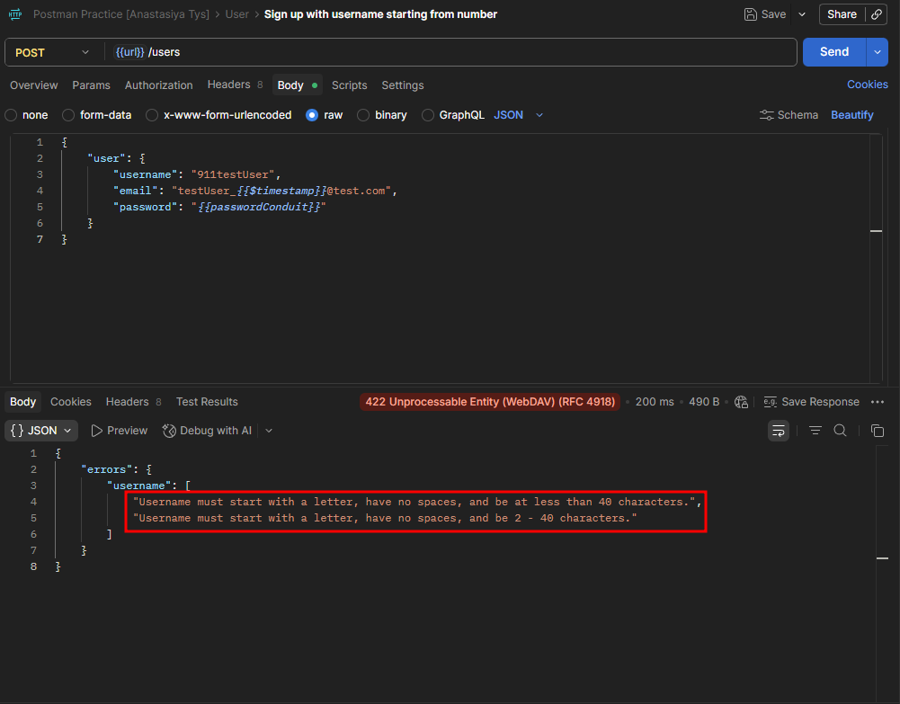

# CPP-3 — Two Contradictory Validation Messages Returned on Sign Up with Username Starting From a Number
**Severity:** Medium
**Priority:** Medium

---

## Environment
| | |
|---|---|
| API | `https://conduit.mate.academy/api/` |
| Endpoint | `POST /users` |
| Tool | Postman 12.13.6 (x64) |
| OS | Windows 10 Pro |

---

## Preconditions
None.

---

## Steps to Reproduce
1. Send `POST /users` with a username starting from a number
2. Check the `username` field in the response errors

---

## Expected Result
One clear, consistent validation message describing the username rules.

---

## Actual Result
Two messages returned simultaneously:
- `"Username must start with a letter, have no spaces, and be at less than 40 characters."`
- `"Username must start with a letter, have no spaces, and be 2 - 40 characters."`

Messages contradict each other on the minimum character requirement — the first implies no minimum, the second states a minimum of 2.

---

## Root Cause
The username field appears to be validated by two separate rules with overlapping but inconsistently worded constraints, both of which fire on the same input and are returned together in the `errors.username` array.

---

## Evidence
