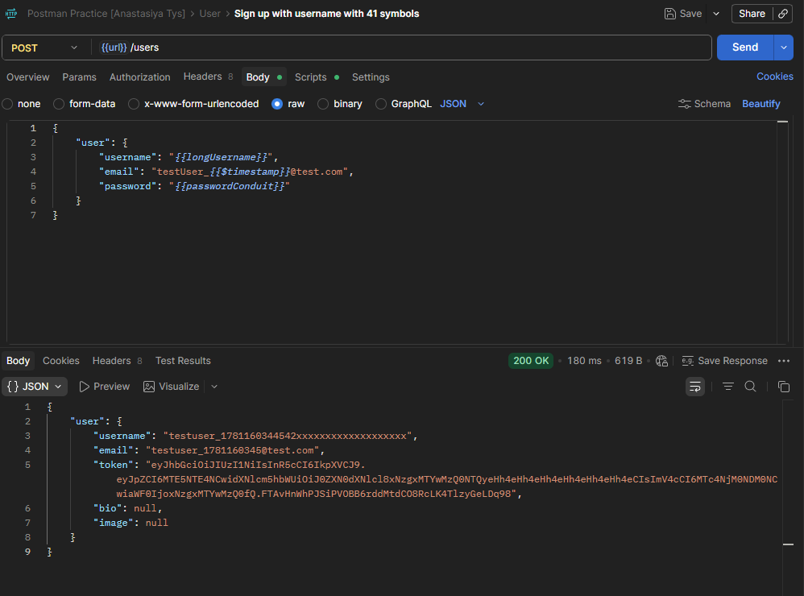

# CPP-4 — User Can Sign Up With Username Longer Than 40 Characters
**Severity:** Medium
**Priority:** Medium

---

## Environment
| | |
|---|---|
| API | `https://conduit.mate.academy/api/` |
| Endpoint | `POST /users` |
| Tool | Postman 12.13.6 (x64) |
| OS | Windows 10 Pro |

---

## Preconditions
None.

---

## Steps to Reproduce
1. Send `POST /users` with a username of 41 or more characters
2. Check the response status code and body

---

## Expected Result
Status code `422` with a validation error — username must be 40 characters or less.

---

## Actual Result
Status code `200 OK` — user created successfully with a 41+ character username. No validation triggered. Tested with usernames longer than 41 characters — same result.

---

## Root Cause
The username length is validated on the frontend / in error messages (see [CPP-3](./CPP-3-contradict-valid-messages.md), which states "2 - 40 characters") but is not enforced server-side on `POST /users`.

---

## Additional Notes
Confirms the backend lacks a maximum-length check despite the documented (and validation-message-stated) 40-character limit.

---

## Evidence
