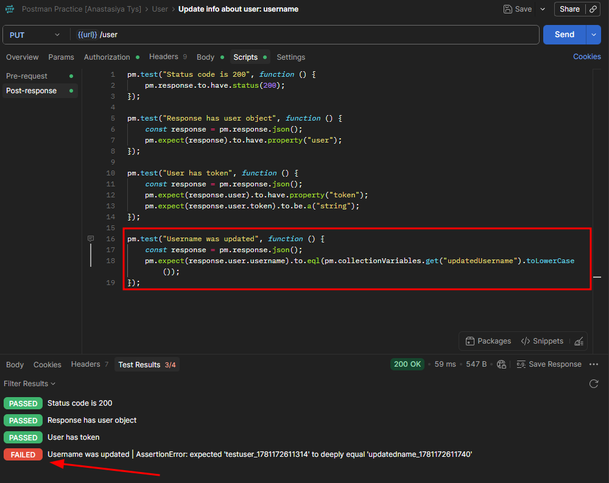
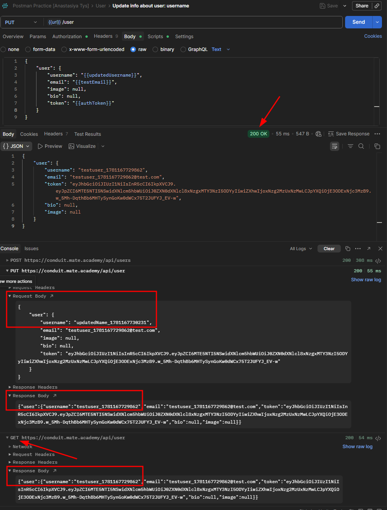

# CPP-5 — Username Is Not Updated Despite 200 OK Response
**Severity:** High
**Priority:** High

---

## Environment
| | |
|---|---|
| API | `https://conduit.mate.academy/api/` |
| Endpoint | `PUT /user` |
| Tool | Postman 12.13.6 (x64) |
| Browser | Microsoft Edge 148.0.3967.70 (64-bit) |
| OS | Windows 10 Pro |

---

## Preconditions
User is logged in.

---

## Steps to Reproduce
1. Register a new user via `POST /users`
2. Save the token from the response
3. Send `PUT /user` with `Authorization: Token <token>` and a new username in the body
4. Check the `username` field in the response
5. Send `GET /user` to confirm whether the change persists

---

## Expected Result
Response returns the updated username. Subsequent `GET /user` confirms the change.

---

## Actual Result
Response returns the original username. Subsequent `GET /user` also returns the original username. No error is returned — status is `200 OK`.

---

## Root Cause
`PUT /user` accepts and returns `200 OK` for a request containing an updated `username`, but the update is not persisted. Updating the same field via the web application works correctly and persists — indicating the API endpoint silently ignores the `username` field specifically, while accepting and applying changes to `bio` and `image` via the same endpoint.

---

## Investigation Steps Performed
- Confirmed `Authorization: Token` format matches what the web app sends
- Confirmed full user object sent in body (`username`, `email`, `image`, `bio`) — same structure as web app
- Confirmed token included in body — same as web app
- Confirmed email matches the registered user
- Ran `GET /user` after `PUT` — username unchanged
- Confirmed bio and image updates via the same endpoint work correctly

---

## Logs

**Request headers:**
```json
Authorization: Token eyJhbGci...

Content-Type: application/json
```

**Request body:**
```json
{
    "user": {
        "username": "updatedName_1781167730231",
        "email": "testuser_1781167729862@test.com",
        "image": null,
        "bio": null,
        "token": "eyJhbGci..."
    }
}
```

**Response body:**
```json
{
    "user": {
        "username": "testuser_1781167729862",
        "email": "testuser_1781167729862@test.com",
        "token": "eyJhbGci...",
        "bio": null,
        "image": null
    }
}
```

**Web app request payload (DevTools):**
```json
{
    "user": {
        "image": null,
        "username": "jainaproudmoore",
        "bio": null,
        "email": "test@data.com",
        "token": "eyJhbGci..."
    }
}
```

**Web app response:**
```json
{
    "user": {
        "username": "jainaproudmoore",
        "email": "test@data.com",
        "token": "eyJhbGci...",
        "bio": null,
        "image": null
    }
}
```

---

## Evidence

