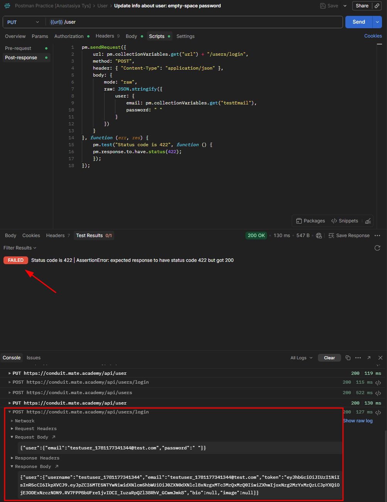
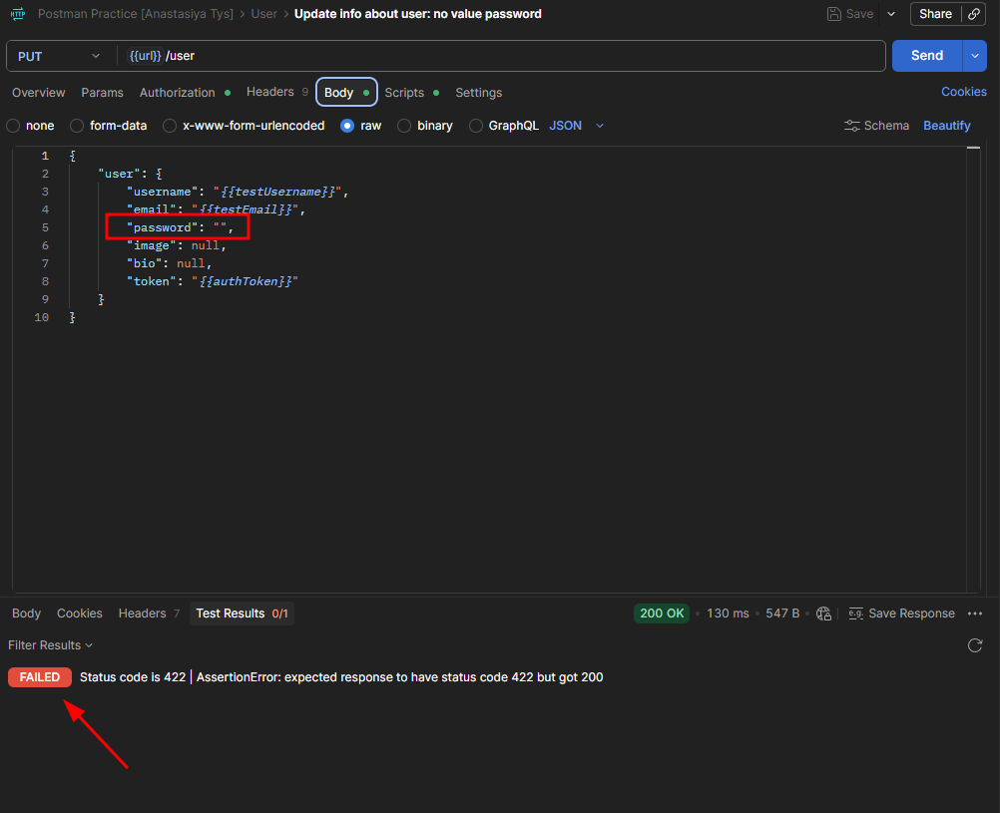

# CPP-6 — Empty and Space-Only Password Is Accepted and Saved Without Validation When Updating User Profile
**Severity:** High
**Priority:** High

---

## Environment
| | |
|---|---|
| API | `https://conduit.mate.academy/api/` |
| Endpoint | `PUT /user` |
| Tool | Postman 12.13.6 (x64) |
| OS | Windows 10 Pro |

---

## Preconditions
User is logged in.

---

## Steps to Reproduce
1. Send `PUT /user` with `"password": " "` (single space) in the body
2. Check response status and attempt login with the space password
3. Repeat steps 1-2 with `"password": ""` (empty string)

---

## Expected Result
`422` with a validation error, consistent with `POST /users`, which correctly returns `"password": "can't be blank"` for empty values.

---

## Actual Result
- **Space password:** `200 OK` — password saved, login with space password succeeds
- **Empty password:** `200 OK` — password saved, login with empty password returns `422` — account effectively locked out

---

## Root Cause
`POST /users` and `POST /users/login` correctly validate the password field, rejecting blank values with `"password": "can't be blank"`. The same validation is missing on `PUT /user`, allowing both empty and space-only passwords to be persisted without rejection.

---

## Additional Notes
The empty password case is particularly severe — a user can successfully save an empty password but is then unable to log in, locking themselves out of their account.

---

## Evidence

