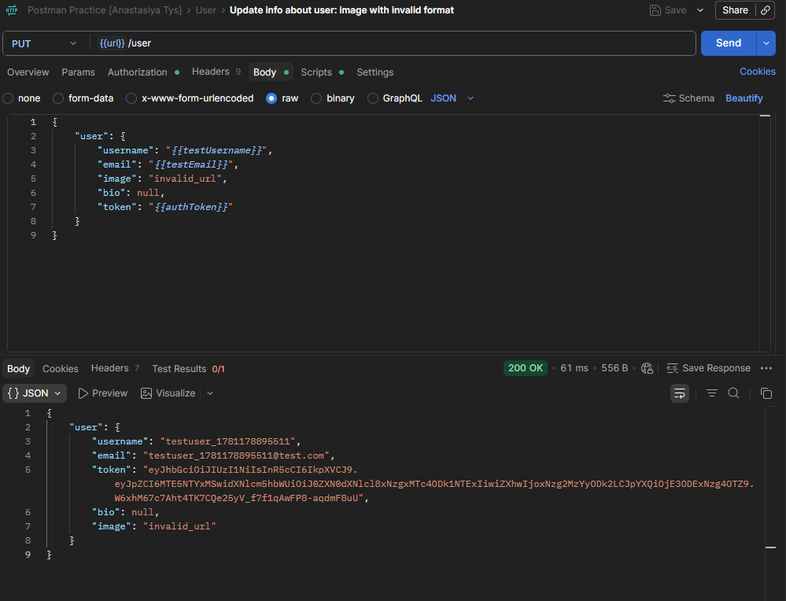
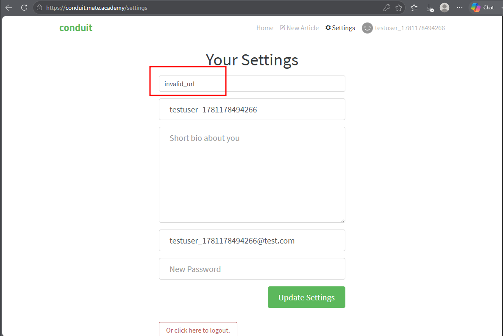

# CPP-7 — Invalid Image URL Is Accepted and Saved Without Validation
**Severity:** Medium
**Priority:** Medium

---

## Environment
| | |
|---|---|
| API | `https://conduit.mate.academy/api/` |
| Endpoint | `PUT /user` |
| Tool | Postman 12.13.6 (x64) |
| Browser | Microsoft Edge 148.0.3967.70 (64-bit) |
| OS | Windows 10 Pro |

---

## Preconditions
User is logged in.

---

## Steps to Reproduce
1. Send `PUT /user` with an invalid image URL (e.g. a plain string, not a URL) in the body
2. Observe the response status and `image` field value
3. Open the Settings page on the website and observe the `image` field

---

## Expected Result
`PUT /user` returns `422` with a validation error informing that the `image` field must contain a valid URL.

---

## Actual Result
`200 OK` — the invalid string is accepted, saved, and displayed in the profile image field on the Settings page. No validation on API or frontend.

---

## Root Cause
Neither the API nor the frontend validates the format of the `image` field on profile update — any string is accepted and persisted as-is, including non-URL values.

---

## Evidence

