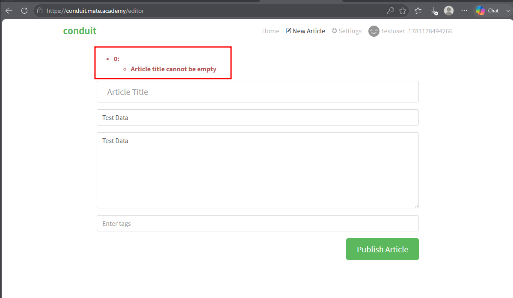
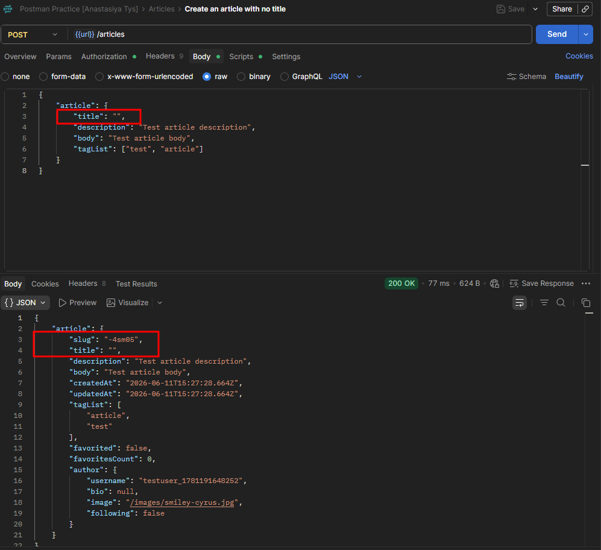

# CPP-8 — Article Can Be Created With Empty Title via API While Frontend Correctly Rejects It
**Severity:** Medium
**Priority:** Medium

---

## Environment
| | |
|---|---|
| API | `https://conduit.mate.academy/api/` |
| Endpoint | `POST /articles` |
| Tool | Postman 12.13.6 (x64) |
| Browser | Microsoft Edge 148.0.3967.70 (64-bit) |
| OS | Windows 10 Pro |

---

## Preconditions
User is logged in to the browser app.

---

## Steps to Reproduce
1. Navigate to [New Article - Conduit](https://conduit.mate.academy/editor)
2. Leave the "Article Title" field empty, fill in other fields with valid data, and click [Publish Article]
3. Observe the validation message
4. Send `POST /articles` via Postman with `"title": ""` and valid values for other fields
5. Observe the response status and slug

---

## Expected Result
`POST /articles` returns `422` — "Article title cannot be empty", consistent with frontend validation.

---

## Actual Result
`200 OK` — article created with empty title. Slug is auto-generated as `-4sm05` — malformed, missing the title portion.

---

## Root Cause
The frontend correctly prevents saving an article with an empty title, displaying "Article title cannot be empty". The API has no equivalent validation on `POST /articles`, creating an inconsistency between frontend and backend behavior — and producing a malformed slug as a side effect.

---

## Evidence

